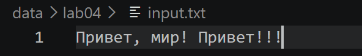
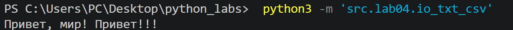
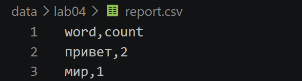
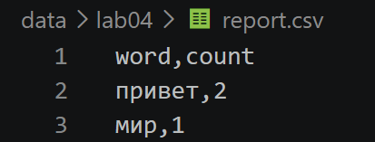
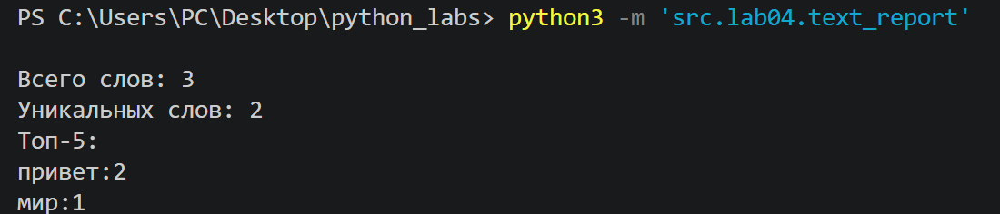
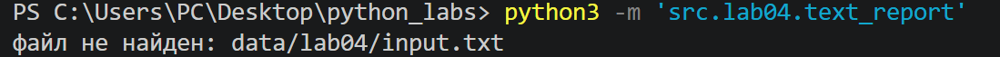
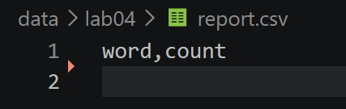
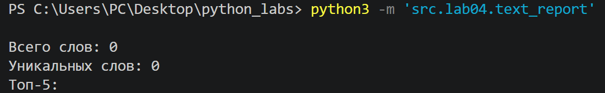

# Отчет по лабораторной работе №4

## Задание A - модуль ``src/lab04/io_txt_csv.py``
### A1. Функция ``read_text``
Функция читает файл целиком и возвращает его содержимое в виде одной строки. По умолчанию используется кодировка UTF-8, но при необходимости можно передать другую кодировку, например ``encoding="cp1251"``.

```python
def read_text(path: str | Path, encoding: str = "utf-8") -> str:
    '''Считывает текст по указанному пути

    Args:
        path: Путь к файлу в формате строки или Path
        encoding: Тип кодировки файла (пример: encoding="cp1251"), по умолчанию utf-8

    Returns:
        Содержимое файла в виде строки

    Raises:
        FileNotFoundError: файл не найден.
        UnicodeDecodeError: кодировка не подходит для этого файла.
    '''
    with open(path, "r", encoding=encoding) as f:
        return f.read()
```
Если файл не найден, возникает ``FileNotFoundError``. При несовпадении кодировки возникает ``UnicodeDecodeError``.




*входные данные + результат чтения содержимого*

### A2. Функция ``write_csv``
Функция записывает строки в CSV-файл. Перед записью проверяется, что все строки имеют одинаковую длину. Если длины отличаются, вызывается ``ValueError``.
```python
def write_csv(rows: list[tuple | list], path: str | Path,
              header: tuple[str, ...] | None = None) -> None:
    '''Записывает строки в CSV-файл

    Args:
        rows: Список строк (кортежи или списки одинаковой длины)
        path: Путь к файлу записи
        header: Заголовок, записывается первой строкой, если передан

    Raises:
        ValueError: строки разной длины
    '''
    p = Path(path)  #превращает путь в path
    rows = list(rows)  #генератор строк -> список

    if rows:
        etalon = len(rows[0])
        for r in rows:
            if len(r) != etalon:
                raise ValueError('Строки разной длины')

    ensure_parent_dir(p)
    with p.open('w', newline="", encoding="utf-8") as f:
        w = csv.writer(f) #создаем писателя csv
        if header is not None:
            w.writerow(header)  #если заголовок передали -> записываем первой строкой
        for r in rows:
            w.writerow(r)  #записываем остальные строки
```
Если передан параметр ``header``, он записывается первой строкой файла.


### A3. Функция ``ensure_parent_dir``
Функция проверяет наличие родительской папки и создает ее вместе со всеми отсутствующими вложенными папками.
```python
def ensure_parent_dir(path: str | Path) -> None:
    '''Проверяет наличие родительских папок, если их нет, то создает их
    Args:
        path: Путь к файлу в формате строки или Path

    Returns:
        None
    '''
    Path(path).parent.mkdir(parents=True, exist_ok=True)
```



*рез. записи данных в CSV-файл*

### Краевые случаи (Задание А)
1. **Пустой файл.** `read_text` возвращает пустую строку `""`.

.png)

2. **`write_csv` с пустым `rows` и `header=None`.** Создаётся пустой файл (0 строк).

3. **`write_csv` с пустым `rows` и `header=("a", "b")`.** Файл содержит только заголовок `a,b`.

.png)

4. **Строки разной длины.** Выбрасывается `ValueError: Строки разной длины`.

.png)


## Задание B — скрипт ``src/lab04/text_report.py``
Скрипт читает текстовые файлы, использует функции ``normalize``, ``tokenize``, ``count_freq`` и ``top_n`` из лабораторной работы №3, а затем сохраняет частоты слов в CSV-файлы.

```python
from src.lib.functools import read_text, write_csv
from src.lib.functools import normalize,tokenize,count_freq,top_n
import sys

try:
    text = read_text("data/lab04/input.txt")
except FileNotFoundError:
    print("файл не найден: data/lab04/input.txt", file=sys.stderr)
    sys.exit(1)
except UnicodeDecodeError:
    print("кодировка не подходит: utf-8", file=sys.stderr)
    sys.exit(1)

words=tokenize(normalize(text))
counts=count_freq(words)
top_5=top_n(counts)

rows=sorted(counts.items(), key=lambda w: (-w[1],w[0]))
write_csv(rows,"data/lab04/report.csv",('word','count'))

print(f'''
Всего слов: {len(words)}
Уникальных слов: {len(set(words))}
Топ-5: ''')
for word,count in top_5:
    print(f'{word}:{count}')
```

### Пример запуска.
```bash
python -m src.lab04.text_report
```
Читается ``data/lab04/input.txt``, результат записывается в ``data/lab04/report.csv``
Результаты выполнения:



*файл `data/lab04/report.csv` (слова и их частоты, отсортированные по убыванию частоты, при равенстве по алфавиту).*




*вывод в консоль: общее число слов, число уникальных слов и топ-5 самых частых.*

### Краевые случаи (задание B)
1. **Входной файл не существует.** Если `data/lab04/input.txt` не найден, скрипт выводит в `stderr` сообщение `файл не найден: data/lab04/input.txt`.



2. **Пустой вход.** Если `input.txt` пустой, `report.csv` содержит только заголовок `word,count`. В консоль выводится `Всего слов: 0`, `Уникальных слов: 0` и пустой список топ-5.




3. **Нестандартная кодировка.** По умолчанию файл читается в UTF-8. Если кодировка не подходит, скрипт выводит `кодировка не подходит: utf-8` в `stderr`. Чтобы прочитать файл в другой кодировке, нужно изменить вызов в коде: `read_text("data/lab04/input.txt", encoding="cp1251")`