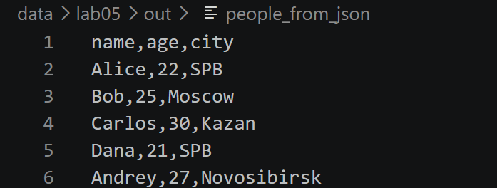
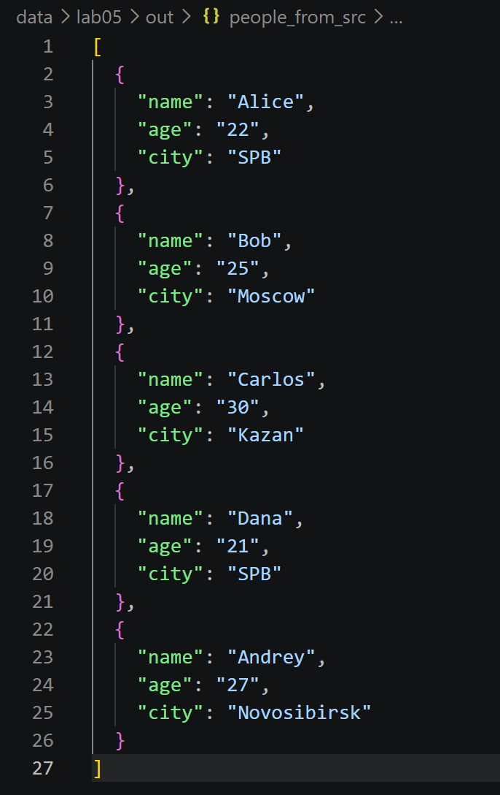
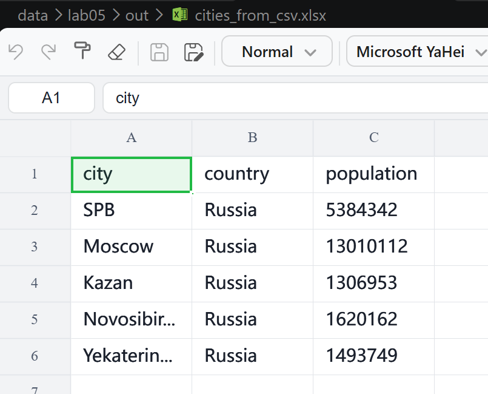

# Отчет по лабораторной работе №5

## Задание A

### А1. Функция ``json_to_csv``.
Функция ``json_to_csv(json_path, csv_path)`` преобразует данные из JSON-файла в CSV-файл.
```python
def json_to_csv(json_path: str, csv_path: str) -> None:
    '''Записывает значения
    Args:
        json_path: Путь к json файлу из которого читаем
        csv_path: Путь к csv файлу куда пишем
    Returns: 
        None
    Raises:
        FileNotFoundError: 
            Указанный JSON файл не найден
        ValueError:
            Указанный файл не формата JSON
            Пустой JSON или неподдерживаемая структура
            Файл JSON пустой или имеет неправильный формат
            Все элементы списка JSON должны быть словарями
    '''
    jp= Path(json_path)
    cp= Path(csv_path)

    if not jp.exists():
        raise FileNotFoundError("файл не найден")
    if jp.suffix.lower() != ".json":
        raise ValueError("указанный файл не формата json")
    with jp.open(encoding="utf-8") as f:
        try:
            data = json.load(f)   #json -> python. загрузили в f
        except json.JSONDecodeError:
            raise ValueError("Пустой JSON или неподдерживаемая структура")
    if not isinstance(data, list) or len(data) == 0:
        raise ValueError('Файл JSON пустой или имеет неправильный формат')
    if not all(isinstance(item, dict) for item in data):
        raise ValueError('Все элементы списка JSON должны быть словарями')

    names=[]
    for item in data:
        for key in item:
            if key not in names:
                names.append(key)
    ensure_parent_dir(cp)
    with cp.open("w",encoding="utf-8",newline="") as f:
        w= csv.DictWriter(f,fieldnames=names)
        w.writeheader()
        w.writerows(data)
```
Функция выполняет следующие действия:
1. Проверяет существование входного файла.
2. Проверяет, что расширение входного файла — .json.
3. Читает данные из JSON-файла в кодировке UTF-8.
4. Проверяет, что данные представляют собой непустой список словарей.
5. Собирает названия всех ключей словарей, сохраняя порядок их первого появления.
6. Создаёт родительскую директорию выходного файла, если это необходимо.
7. Записывает заголовок и данные в CSV-файл в кодировке UTF-8.

Пример вызова: 
``` python 
json_to_csv("data/lab05/samples/people.json","data/lab05/out/people_from_json")
```

### А2. Функция ``csv_to_json``.
Функция ``csv_to_json(csv_path, json_path)`` преобразует данные из CSV-файла в JSON-файл.
```python
def csv_to_json(csv_path: str, json_path: str) -> None:
    '''Записывает значения
    Args:
        csv_path: Путь к csv файлу из которого читаем
        json_path: Путь к json файлу куда пишем
    Returns: 
        None
    Raises:
        FileNotFoundError: 
            Указанный CSV файл не найден
        ValueError:
            Указанный файл не формата CSV
            Файл CSV пустой
            Файл CSV не содержит данных
    '''
    jp=Path(json_path)
    cp=Path(csv_path)

    if not cp.exists():
        raise FileNotFoundError("Указанный CSV файл не найден")
    if cp.suffix.lower() != '.csv':
        raise ValueError("Указанный файл не формата CSV")
    with cp.open("r",encoding='utf-8',newline='') as f:
        reader = csv.DictReader(f)
        if reader.fieldnames is None:  #заголовки отсуствуют
            raise ValueError("Файл CSV пустой")

        data = list(reader)  #список словарей
    if not data:
        raise ValueError("Файл CSV не содержит данных")

    ensure_parent_dir(jp)
    with jp.open('w',encoding='utf-8') as p:
        json.dump(data, p, ensure_ascii=False, indent=2) #python -> json
        #(что записываем, открытый файл\куда пишем, настройки)
```
Функция выполняет следующие действия:
1. Проверяет существование входного файла.
2. Проверяет, что расширение входного файла — .csv.
3. Читает данные из CSV-файла в кодировке UTF-8.
4. Проверяет наличие заголовка и хотя бы одной строки данных.
5. Преобразует строки CSV в список словарей, используя заголовки в качестве ключей.
6. Создаёт родительскую директорию выходного файла, если это необходимо.
7. Сохраняет данные в JSON-файл в кодировке UTF-8 с отступом в два пробела и сохранением кириллицы.

Пример вызова: 
``` python 
csv_to_json("data/lab05/samples/people.csv","data/lab05/out/people_from_src")
```
Запуск:
```powershell
python -m src.lab05.json_to_csv
```
При запуске создаются следующие файлы:

- `data/lab05/out/people_from_json`;
- `data/lab05/out/people_from_src`.


## Задание B. Функция ``csv_to_xlsx``.
Функция ``csv_to_xlsx(csv_path, xlsx_path)`` преобразует данные из CSV-файла в XLSX-файл.
```python
def csv_to_xlsx(csv_path: str, xlsx_path: str) -> None:
    '''Конвертирует CSV файл в формат XLSX.

        Args:
            csv_path: Путь к исходному CSV файлу
            xlsx_path: Путь для сохранения XLSX файла

        Returns:
            None

        Raises:
            FileNotFoundError:
                Указанный CSV файл не найден
            ValueError:
                Указанный файл не формата CSV
                Файл CSV пустой
    '''
    cp=Path(csv_path)
    xlp=Path(xlsx_path)

    if not cp.exists():
        raise FileNotFoundError("Указанный CSV файл не найден")
    if cp.suffix.lower() != ".csv":
        raise ValueError("Указанный файл не формата CSV")
    rows=[]
    with cp.open('r',encoding='utf-8',newline='') as f:
        rows=list(csv.reader(f))  #список списков
        #reader: каждая строка со значениями -> список значений
    if not rows:
        raise ValueError("Файл CSV пустой")

    wb = Workbook()
    ws = wb.active
    ws.title = "Sheet1"
    for row in rows:
        ws.append(row)
    ensure_parent_dir(xlp)
    wb.save(xlp)
```
Функция выполняет следующие действия:
1. Проверяет существование входного файла.
2. Проверяет, что расширение входного файла — .csv.
3. Читает данные из CSV-файла в кодировке UTF-8.
4. Проверяет, что CSV-файл не пустой.
5. Создаёт новую книгу Excel и активный лист с названием Sheet1.
6. Последовательно записывает строки CSV-файла в лист Excel.
7. Создаёт родительскую директорию выходного файла, если это необходимо.
8. Сохраняет файл в формате XLSX.

Пример вызова:
```python
csv_to_xlsx("data/lab05/samples/cities.csv","data/lab05/out/cities_from_csv.xlsx")
```

Запуск:
``` powershell
python -m src.lab05.csv_to_xlsx
```

## Сценарии демонстрации
### 1. JSON→CSV


### 2. CSV→JSON


### 3. CSV → XLSX
