# Отчет по лабораторной работе №6

## CLI_text

### cat
Функция принимает на вход путь к файлу и выводит каждую его строку с нумерацией или без в зависимости от того, укажет ли пользователь соответствующий аргумент или нет(-n). Команда проверяет наличие файла, кодировку utf-8 (обязательно!).
```python
def cat_cmd(input_path: str, numbers: bool=False) -> None:
    path=Path(input_path)
    if not path.exists():
        raise FileNotFoundError("Файл не найден")
    with open(path, "r", encoding='utf-8') as f:
        for i,line in enumerate(f,start=1):
            if numbers:
                print(f'{i} {line}')
            else:
                print(f'{line}')
```

### stats
Команда приниимает на вход путь к файлу, который кодирован utf-8, проверяет его наличие и обрабатывает слова. С помощью функций из ЛР3 создает статистику и выводит ее в виде таблицы. В зависимости от переданного аргумента в top, будет выводиться топ из стольки слов.
```python
def stats_cmd(input_path: str, top: int=5) -> None:
    path=Path(input_path)
    if not path.exists():
        raise FileNotFoundError("Файл не найден")

    text=read_text(path)
    tokens=tokenize(normalize(text))
    freq=count_freq(tokens)

    total_words=len(tokens)
    unique_words=len(set(tokens))
    top_words=top_n(freq,top)

    print(f'Всего слов: {total_words}')
    print(f'ВСего уникальных слов: {unique_words}')
    print(f'Топ-{top}:')
    for w,c in top_words:
        print(f'{w}:{c}')
```

### main()
Основная функция создает ArgumentParser, добавляет подкоманды cat и stats с помощью add_subparsers и уже в низ с помощью add_arguement описывает подаваемые аргументы. Выбор выполняемой операции определяется по значению args.command.
```python
def main():
    parser = argparse.ArgumentParser(description="CLI‑утилиты лабораторной №6")
    subparsers = parser.add_subparsers(dest="command")

    # подкоманда cat
    cat_parser = subparsers.add_parser("cat", help="Вывести содержимое файла")
    cat_parser.add_argument("--input", required=True)
    cat_parser.add_argument("-n", action="store_true", help="Нумеровать строки")

    # подкоманда stats
    stats_parser = subparsers.add_parser("stats", help="Частоты слов")
    stats_parser.add_argument("--input", required=True)
    stats_parser.add_argument("--top", type=int, default=5)

    args = parser.parse_args()

    if args.command is None:
        parser.error("Нужно указать подкоманду: cat или stats")
    if args.command == "stats" and args.top < 1:
        parser.error("--top должен быть больше 0")
    
    try:
        if args.command == "cat":
            cat_cmd(args.input, args.n)
        elif args.command == "stats":
            stats_cmd(args.input, args.top)
    except FileNotFoundError:
        parser.error(f"Файл не найден: {args.input}")
    except UnicodeDecodeError:
        parser.error(f"Файл {args.input} написан в кодировке, отличной от UTF-8")
```

## Запуск

### Запуск сat без нумерации
``python -m src.lab06.cli_text cat --input data/lab05/samples/people.csv``

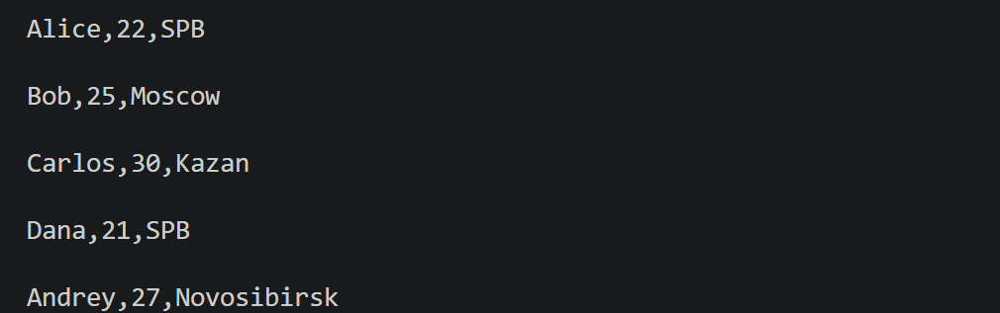

### Запуск cat с нумерацией
``python -m src.lab06.cli_text cat --input data/lab05/samples/people.csv -n``

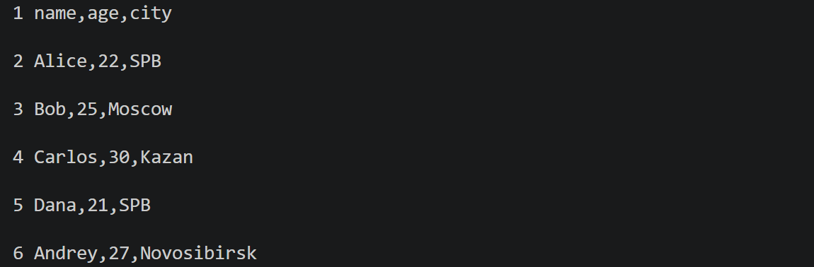

### Запуск stats без указания слов в топе
``python -m src.lab06.cli_text stats --input data/lab06/txt_sample.txt``

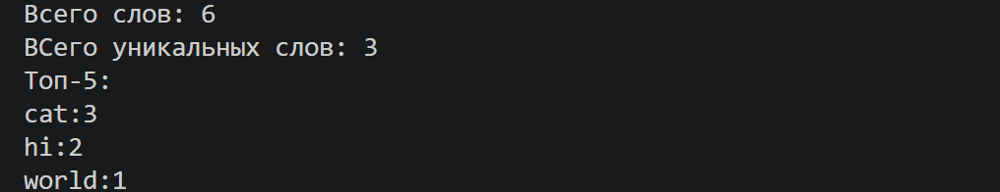

### Запуск stats с указанием слов в топе
``python -m src.lab06.cli_text stats --input data/lab06/txt_sample.txt --top 3``

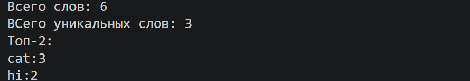

## Обработка ошибок
* FileNotFoundError - входной файл не найден
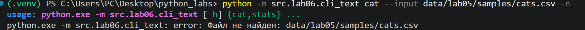

* UnicodeDecodeError — невозможно декодировать содержимое файла с использованием UTF-8.

* parser.error() — аргумент --top имеет недопустимое значение.
``python -m src.lab_06.cli_text stats --input data/samples/people.txt --top -3``
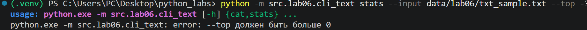

### Проверка справки ``--help``
* Общая справка по двум функциям
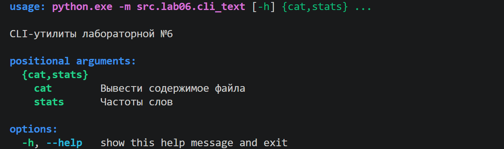

* Справка по функции ``cat``
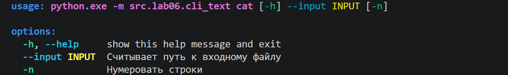

* Справка по функции ``stats``
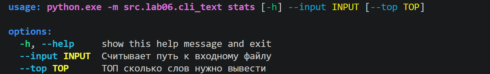

## CLI_convert
Программа реализует интерфейс для управления функциями реализованными в ЛР5. С помощью argparse определяются три подкоманды, каждая подкоманда принимает два обязательных аргумента: --in для указания исходного файла и --out для указания выходного файла. После обработки аргументов программа определяет выбранную подкоманду и вызывает соответствующую функцию из ЛР5.
``` python
def main():
    parser = argparse.ArgumentParser(description="Конвертеры данных")
    sub = parser.add_subparsers(dest="command")

    p1 = sub.add_parser("json2csv", help='Конвертировать JSON в CSV')
    p1.add_argument("--in", dest="input", required=True, help="Входной файл JSON")
    p1.add_argument("--out", dest="output", required=True, help="Выходной файл CSV")

    p2 = sub.add_parser("csv2json", help='Конвертировать CSV в JSON')
    p2.add_argument("--in", dest="input", required=True, help="Входной файл CSV")
    p2.add_argument("--out", dest="output", required=True, help="Выходной файл JSON")

    p3 = sub.add_parser("csv2xlsx", help='Конвертировать CSV в XLSX')
    p3.add_argument("--in", dest="input", required=True, help="Входной файл CSV")
    p3.add_argument("--out", dest="output", required=True, help="Выходной файл XLSX")

    args = parser.parse_args()

    if args.command is None:
        parser.error("Нужно указать подкоманду: json2csv, csv2json или csv2xlsx")

    try:
        if args.command == "json2csv":
            json_to_csv(Path(args.input),Path(args.output))

        elif args.command == "csv2json":
            csv_to_json(Path(args.input),Path(args.output))

        elif args.command == "csv2xlsx":
            csv_to_xlsx(Path(args.input),Path(args.output))

    except FileNotFoundError:
        parser.error(f'Файл не найден: {args.input}')
    except UnicodeDecodeError:
        parser.error(f'Файл {args.input} написан в кодировке, отличной от UTF-8')
    except ValueError as error:
        parser.error(str(error))
```

### Запуск
#### JSON -> CSV
``python -m src.lab06.cli_convert json2csv --in data/lab05/samples/people.json --out data/lab06/out/people.csv``

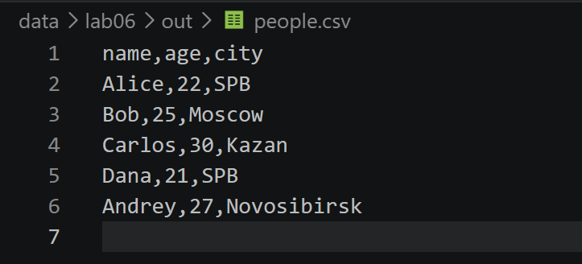

#### CSV -> JSON
``python -m src.lab06.cli_convert csv2json --in data/lab05/samples/people.csv --out data/lab06/out/people.json``

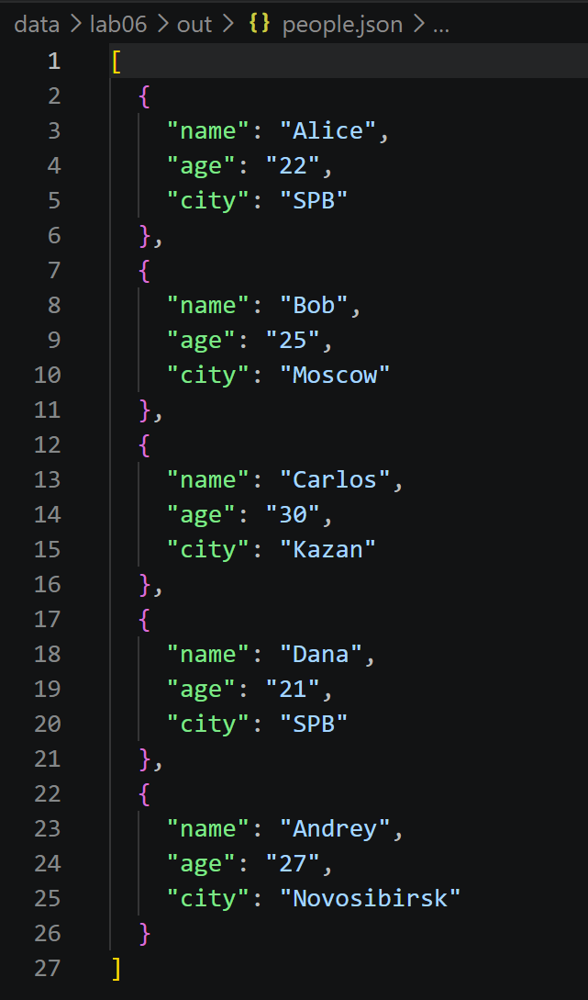

#### CSV -> XLSX
``python -m src.lab06.cli_convert csv2xlsx --in data/lab05/samples/cities.csv --out data/lab06/out/cities.xlsx``

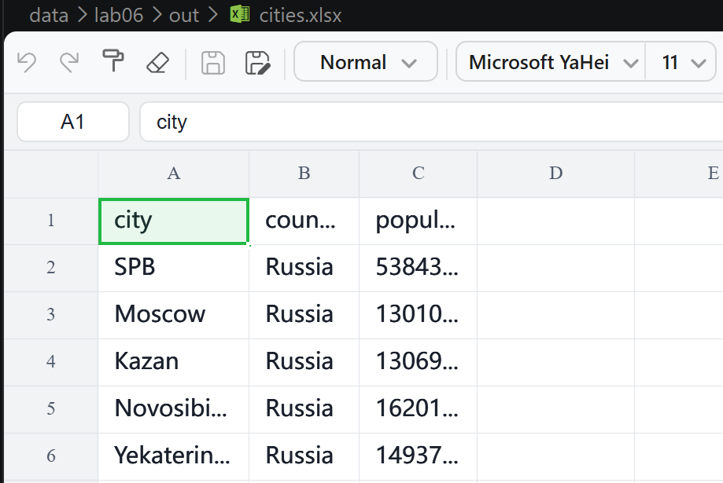

## Обработка ошибок
* FileNotFoundError - то же, что и в cli_text.

* UnicodeDecodeError — невозможно декодировать содержимое файла с использованием UTF-8.

* ValueError - при отсутствии важных аргументов.
``python -m src.lab_06.cli_convert json2csv``
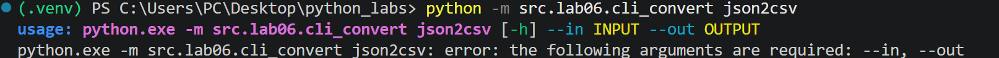


### Проверка справки ``--help``
* Общая справка по функциям

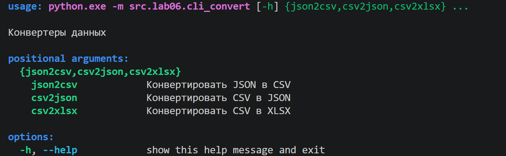

* Справка по функции json2csv

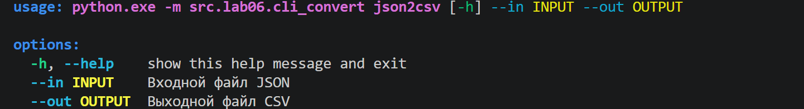

* Справка по функции csv2json

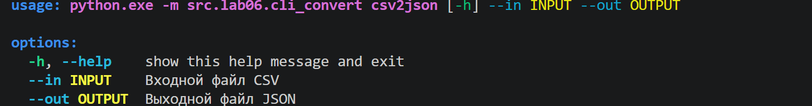

* Справка по функции csv2xlsx

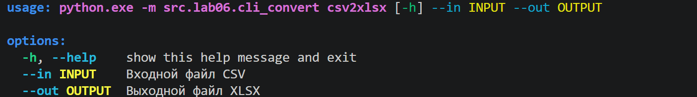