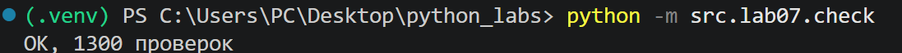
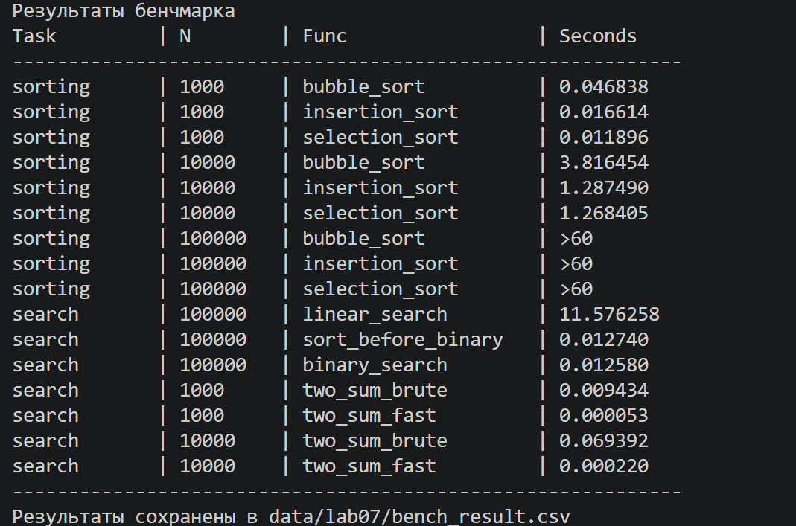
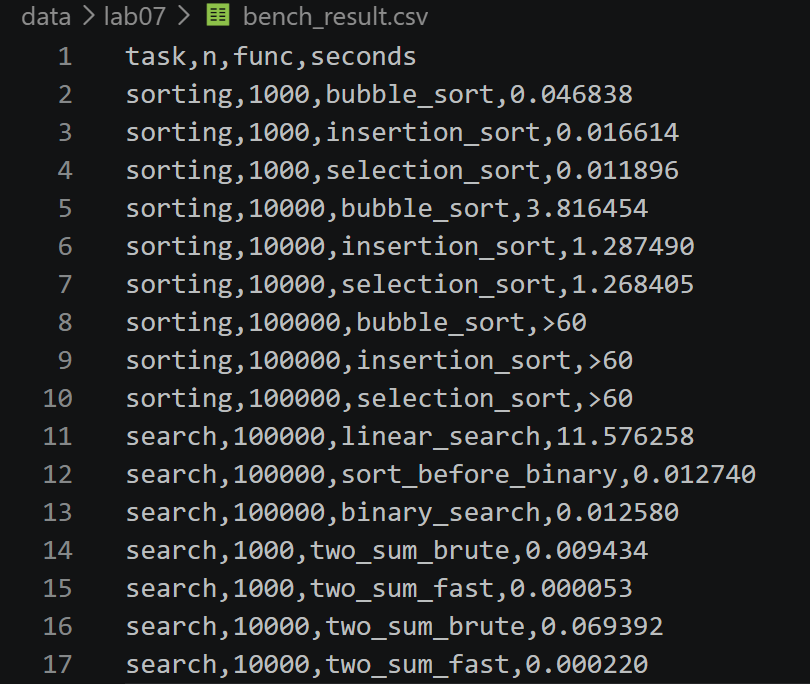

# Отчет по лабораторной работе №7

## Задание А. search

### linear_search
Последовательно перебирает элементы списка слева направо и возвращает индекс первого найденного x. Если элемента нет, возвращает -1. Работает с неотсортированным списком.

сложность: O(N)
```python 
def linear_search(nums, x):
    ''' Возвращает индекс первого вхождения х или -1 '''
    for i in range(len(nums)):
        if nums[i]==x:
            return i
    return -1
```


### binary_search
Ищет x в отсортированном списке. На каждом шаге сравнивает x со средним элементом и отбрасывает половину списка. Если элемент не найден, возвращает -1.

сложность: O(logN)
```python
def binary_search(sorted_nums, x):
    ''' Ищет x  в отсортированном списке.
    Для неотсортированного списка результат не определен. '''
    lo, hi = 0, len(sorted_nums)-1
    while lo<=hi:
        mid = (lo+hi) // 2
        if sorted_nums[mid] == x:
            return mid
        elif sorted_nums[mid] < x:
            lo = mid + 1
        else:
            hi = mid -1
    return -1
```

### two_sum_brute
Перебирает все возможные пары элементов и проверяет, равна ли их сумма target. При нахождении подходящей пары возвращает её индексы, иначе None.

сложность: O(N^2)
```python 
def two_sum_brute(nums, target):
    ''' Ищет пару индексов таких чисел, сумма которых равна target. '''
    for i in range(len(nums)):
        for j in range(i+1,len(nums)):
            if (nums[i]+nums[j])==target:
                return i,j
    return None
```

### two_sum_fast
За один проход по списку ищет нужную пару с помощью словаря seen. Для каждого элемента вычисляет, какое число нужно для получения target, и проверяет, встречалось ли оно раньше.

сложность: O(N)
```python
def two_sum_fast(nums, target):
    ''' То же, что two_sum_brute, но за один проход со словарём. '''
    seen={}
    for i in range(len(nums)):
        need = target - nums[i]
        if need in seen:
            return seen[need],i
        seen[nums[i]] = i
    return None
```

## Задание B. sorting

### bubble_sort
Сравнивает соседние элементы и меняет их местами, если они стоят в неправильном порядке. После каждого прохода самый большой элемент перемещается в конец. Исходный список не меняется.

сложность: O(N^2)
```python
def bubble_sort(nums):
    ''' Возвращает отсортированный список методом пузырьковой сортировки. 
    Исходный список не меняется.'''
    ln = len(nums)
    result=nums[:]
    for i in range(0,ln):
        for j in range(0,ln-i-1):
            if result[j] > result[j+1]:
                result[j],result[j+1] = result[j+1],result[j]
    return result
```

### insertion_sort
Поочерёдно берёт элементы и вставляет каждый из них на правильное место среди уже отсортированной части списка, сдвигая большие элементы вправо. Исходный список не меняется.

сложность: O(N^2), O(N) для уже отсортированного
```python
def insertion_sort(nums):
    ''' Возвращает отсортированный список методом сортировки вставками.
    Исходный список не меняется. '''
    result = nums[:]
    for i in range(1,len(result)):
        key=result[i]
        j=i-1
        while j>=0 and result[j]>key:
            result[j+1] = result[j]
            j-=1
        result[j+1]=key
    return result
```
### selection_sort
На каждом шаге ищет минимальный элемент в неотсортированной части списка и ставит его на текущую позицию. Исходный список не меняется.

сложность: O(N^2)
```python
def selection_sort(nums):
    ''' Возвращает отсортированный список методом сортировки выбором.
    Исходный список не меняется. '''
    result=nums[:]
    ln=len(nums)
    for i in range(0,ln):
        min_indx = i
        for j in range(i+1,ln):
            if result[j] < result[min_indx]:
                min_indx = j
        result[i],result[min_indx]=result[min_indx],result[i]
    return result
```

## Задание C. check
### Импортируемые функции и библиотеки
* random - библиотека, для генерации случайных чисел. Используется при генерации списков и чисел для проверок.
* src.lab07.sorting import (...) - функции сортировок.
* src.lab07.search (...) - функции поиска.
``` python 
import random
from src.lab07.sorting import bubble_sort, insertion_sort, selection_sort
from src.lab07.search import linear_search, binary_search, two_sum_brute, two_sum_fast
```

### check_sorting
Проверяет сортировки на случайных списках, сравнивает результат с sorted() и проверяет сохранность исходного списка. При расхождении поднимается AssertionError с данными, на которых оно случилось.
``` python
def check_sorting(fn, trials=100):
    ''' Проверяет сортировку на случайных списках.'''
    count=0
    for _ in range(trials):
        n = random.randint(0, 50)
        nums = [random.randint(-100, 100) for _ in range(n)]
        original = list(nums)
        result = fn(nums) #вызов моей сортировки
        assert result == sorted(nums), f"{fn.__name__} ошиблась на {nums}: {result}"
        assert nums == original, f"{fn.__name__} изменила исходный список"
        count+=1
    return count
```

### check_search
Проверяет линейный и бинарный поиск на случайных списках, сравнивая результаты с ожидаемыми. При расхождении поднимается AssertionError с данными, на которых оно случилось.
```python
def check_search(trials=100):
    count = 0
    for _ in range(trials):
        n=random.randint(1,50)
        nums = [random.randint(-20,20) for _ in range(n)]

        # --- линейный поиск ---
        linear_targets = [nums[0], nums[-1], random.randint(-20,20)]
        for x in linear_targets:
            try:
                expected = nums.index(x)
            except ValueError:
                expected = -1
            result = linear_search(nums,x)
            assert result == expected, f'linear_search ошиблась на {nums}, x={x}: {result}, ожидалось {expected}'
            count+=1

        # --- бинарный поиск ---
        sorted_nums=sorted(nums)
        binary_targets = [-21, 21, random.randint(-20,20)]
        if sorted_nums:
            binary_targets.append(sorted_nums[-1])
            binary_targets.append(sorted_nums[0])
            binary_targets.append(random.choice(sorted_nums))
        
        for x in binary_targets:
            try:
                expected = sorted_nums.index(x)
            except ValueError:
                expected = -1
            result = binary_search(sorted_nums,x)
            if expected == -1:
                assert result == -1, f"binary_search ошиблась на {sorted_nums}, x={x}: {result}, ожидалось -1"
            else:
                assert result != -1, f"binary_search не нашла {x} в {sorted_nums}"
                assert sorted_nums[result] == x, f"binary_search вернула {result}, а там не {x}: {sorted_nums}"
            count+=1
    return count
```

### check_two_sums
Проверяет оба алгоритма поиска пары чисел и правильность полученных результатов. При расхождении поднимается AssertionError с данными, на которых оно случилось.
```python
def check_two_sum(trials=100):
    count=0
    for _ in range(trials):
        n = random.randint(0, 20)
        nums = [random.randint(-20, 20) for _ in range(n)]
        target = random.randint(-30, 30)
        a = two_sum_brute(nums, target)
        b = two_sum_fast(nums, target)
        assert (a is None) == (b is None), f"расходятся на {nums}, target={target}: brute={a}, fast={b}"
        if a is not None:
            assert (nums[a[0]]+nums[a[1]])==target, f"расходятся на {nums}, target={target}: a1= {nums[a[0]],a[0]}, a2= {nums[a[1]],a[1]}"
        if b is not None:
            assert (nums[b[0]]+nums[b[1]])==target, f"расходятся на {nums}, target={target}: b1= {nums[b[0]],b[0]}, b2= {nums[b[1]],b[1]}"
        count+=1
    return count
```

### main
Подсчет общего числа проверок + выводится подтверждение, что все n проверок пройдены (300 для сортировок, 900 для поиска и 100 для Two Sum.)
```python
if __name__ == "__main__":
    random.seed(42)
    N=0
    for fn in (bubble_sort, insertion_sort, selection_sort):
        N+=check_sorting(fn)
    N+=check_search()
    N+=check_two_sum()
    print(f"OK, {N} проверок")
```

### Как запустить
``` python -m src.lab07.check ```

### Что выведет?


## Задание D. bench
### Импортируемые функции и библиотеки
* CSV - необходимая библиотека для оформления вывода бенчмарка.
* timeit - библиотека, чтобы замерить время выполнения сортировок и поиска.
* random - библиотека, чтобы генерировать случайные числа. Используется в создании рандомных списков и чисел для проверки.
* write_csv - функция, чтобы оформить данные в csv файл.
* src.lab07.search (...) - функции поиска.
* src.lab07.sorting (...) - функции сортировок.
```python
import csv
import timeit
import random
from src.lab04.io_txt_csv import write_csv
from src.lab07.search import linear_search, binary_search, two_sum_brute, two_sum_fast
from src.lab07.sorting import bubble_sort, insertion_sort, selection_sort
```
### new_data
Генерирует три списка длины 1_000,10_000,100_000 с рандомными числами и записывает их в три файла csv.
```python 
def new_data():
    ''' генерирует списки с рандомными числами'''
    sizes = (1_000,10_000,100_000)
    for n in sizes:
        nums = [random.randint(-1_000_000,1_000_000) for _ in range(n)]
        rows = [[x] for x in nums]
        write_csv(rows,f'data/lab07/samples/{n}_sort.csv',header=('value',))
```
### read_numbers
Считывает данные из csv и возвращает список.
```python
def read_numbers(path):
    ''' считывает данные из csv '''
    with open(path, encoding="utf-8") as f:
        return [int(row["value"]) for row in csv.DictReader(f)]
```

### bench_sorts
Считывает данные из csv файлов, измеряет время сортировок с помощью timeit. Результат сохраняется в списке с кортежами данных.
```python
def bench_sorts():
    rows=[]
    for n in (1_000,10_000,100_000):
        data = read_numbers(f'data/lab07/samples/{n}_sort.csv')
        funcs = [("bubble_sort", bubble_sort), ("insertion_sort", insertion_sort), ("selection_sort", selection_sort)]

        for name, fc in funcs:
            if n<=10_000:
                time = timeit.timeit(lambda: fc(data), number=1)
                rows.append(("sorting", n, name, f"{time:.6f}"))
            else:
                rows.append(("sorting", n, name, ">60"))
    return rows
```

### bench_search
Измеряет время линейного, бинарного поиска и двух вариантов two_sum с помощью timeit. Полученные данные записываются в кортежи, а потом объединяются в список.
```python
def bench_search():
    rows=[]
    data = read_numbers(f'data/lab07/samples/100000_sort.csv')
    targets = [random.choice(data) for _ in range(10_000)]

    # --- линейный поиск ---
    time_ls = timeit.timeit(lambda: [linear_search(data,t) for t in targets],  number =1)
    rows.append(("search", 100_000, "linear_search", f"{time_ls:.6f}"))

    # --- бинарный поиск ---
    time_sbb=timeit.timeit(lambda: sorted(data), number=1)
    rows.append(("search", 100_000, "sort_before_binary", f"{time_sbb:.6f}"))
    sorted_data= sorted(data)

    time_bs = timeit.timeit(lambda: [binary_search(sorted_data,t) for t in targets],  number =1)
    rows.append(("search", 100_000, "binary_search", f"{time_bs:.6f}"))

    # --- суммы ---
    for n in (1_000,10_000):
        data_ts = read_numbers(f'data/lab07/samples/{n}_sort.csv')
        a, b = random.sample(data_ts, 2)
        target = a+b

        time_tsb = timeit.timeit(lambda: two_sum_brute(data_ts,target), number=1)
        rows.append(("search", n, "two_sum_brute", f"{time_tsb:.6f}"))

        time_tsf = timeit.timeit(lambda: two_sum_fast(data_ts,target), number=1)
        rows.append(("search", n, "two_sum_fast", f"{time_tsf:.6f}"))

    return rows
```

### main
Объединяет все полученные данные из предыдущих функций в общий csv файл и выводит эти же данные в виде таблицы в терминал.
```python
def main():
    random.seed(42)
    new_data() #создаем три файла

    header = ("task", "n", "func", "seconds")
    rows=[]
    rows.extend(bench_sorts())
    rows.extend(bench_search())

    write_csv(rows, 'data/lab07/bench_result.csv', header)

    print("Результаты бенчмарка")
    print(f"{'Task':<12} | {'N':<8} | {'Func':<20} | {'Seconds':<12}")
    print('-'*60)
    for t, n, f, s in rows:
        print(f"{t:<12} | {n:<8} | {f:<20} | {s:<12}")
    print('-'*60)
    print("Результаты сохранены в data/lab07/bench_result.csv")
```
### Как запустить?
``` python -m src.lab07.bench ```

### Что выведет?
* В терминал


* В bench_result.csv


## Вопросы
1. _Почему пузырёк при росте n в 10 раз замедляется в ~100 раз, а sorted — в ~12?_
Так как пузырьковая сортировка имеет сложность O(N^2), то при увелечении n в 10 раз, количество операций увеличивается в n^2 раз, следовательно время работы возрастает в 100 раз. Встроенная функция sorted() использует более эффективный алгоритм со сложностью O(N log N), поэтому при увеличении размера списка в 10 раз время ее работы возрастает примерно в 12 раз, а не в 100.

2. _Почему бинарный поиск бесполезен без предварительной сортировки, и когда она окупается?_
Бинарный поиск работает только с отсортированным списком, поскольку использует порядок элементов, чтобы каждый раз отбрасывать половину списка. Сама сортировка требует дополнительного времени O(N log N), поэтому при одном-двух запросах линейный поиск по неотсортированному списку может быть выгоднее. При большом количестве запросов сортировка окупается, так как каждый последующий поиск выполняется за O(log N) вместо O(N).

3. _Что показал check.py: сколько прогонов, нашёл ли расхождения, как исправили?_
Было выполнено 1300 проверок: 300 для сортировок, 900 для поиска и 100 для Two Sum. Ошибок и расхождений не найдено, все проверки успешно пройдены. 
Программа вывела:
