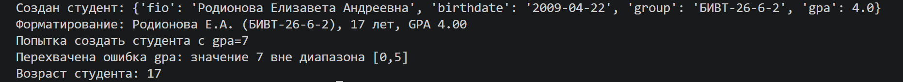
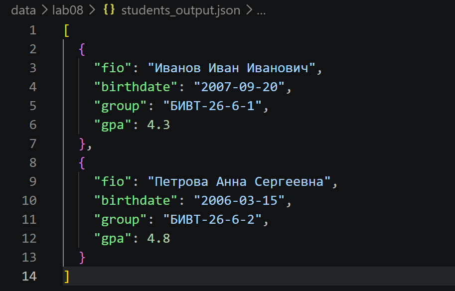
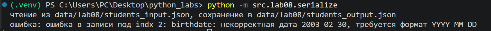
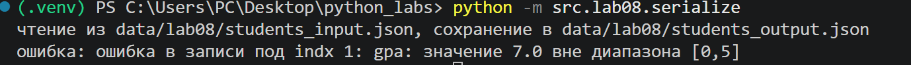

# Отчет по лабораторной работе №8

## Задание А. Реализация модели Student / модуль `models.py`
Модель Student описывает запись в виде словаря с фиксированным набором ключей, закреплённым в константе student_fields = ("fio", "birthdate", "group", "gpa")

### Используемые библиотеки
- `datetime.date` – стандартная библиотека, разбор дат (`date.fromisoformat`) и вычисление возраста.
```python
from datetime import date
```

### Проверки полей / check_(...)
Каждая проверяет одно поле и при проблеме бросает `ValueError` с названием поля и причиной.
1. ```check_fio``` - ФИО должно существовать и быть строкой.
```python
def check_fio(value) -> None:
    if not isinstance(value,str):
        raise ValueError(f"fio: ожидается строка, получено {type(value)}")
    if not value.strip():
        raise ValueError('fio: не должно быть пустым')
```
2. ```check_data``` - дата должна существовать, не должна быть в будущем и иметь формат YYYY-MM-DD.
```python
def check_data(value) -> None:
    if not isinstance(value,str):
        raise ValueError(f"birthdate: ожидается строка, получено {type(value)}")
    if not value.strip():
        raise ValueError('birthdate: не должно быть пустым')
    
    try:
        born = date.fromisoformat(value)
    except ValueError:
        raise ValueError(f'birthdate: некорректная дата {value}, требуется формат YYYY-MM-DD')
    if born > date.today():
        raise ValueError(f'{value} дата из будущего, студент еще не родился')
```
3. ```check_group``` - группа должна быть строкой.
```python
def check_group(value) -> None:
    if not isinstance(value,str):
        raise ValueError(f"group: ожидается строка, получено {type(value)}")
    if not value.strip():
        raise ValueError('group: не должно быть пустым')
```
4. ```check_data``` - `gpa` должен быть числом (`bool` исключён) в диапазоне [0,5].
```python
def check_gpa(value) -> None:
    if isinstance(value,bool) or not isinstance(value,(int,float)):
        raise ValueError(f"gpa: ожидается число, получено {type(value)}")
    if not (0 <= value <= 5):
        raise ValueError(f"gpa: значение {value} вне диапазона [0,5]")
```

### make_student(fio, birthdate, group, gpa) -> dict
Конструктор записи. Проверяет все четыре поля, затем возвращает словарь. У `fio` и `group` обрезаются пробелы по краям, `gpa` приводится к `float`.
```python
def make_student(fio, birthdate, group, gpa) -> dict:
    '''Собрать запись студента, проверив каждое значение'''
    check_fio(fio)
    check_data(birthdate)
    check_group(group)
    check_gpa(gpa)

    return {
        'fio': fio.strip(),
        'birthdate': birthdate,
        'group': group.strip(),
        'gpa': float(gpa),
    }
```

### validate_student(rec) -> None
Проверяет готовый словарь. Сначала что это словарь, затем что набор ключей ровно `student_fields` (без лишних и пропущенных), затем значения теми же проверками, что в `make_student`. При ошибке бросает `ValueError`.
```python
def validate_student(rec) -> None:
    '''Проверить итоговую запись, при ошибке ValueError'''
    if not isinstance(rec, dict):
        raise ValueError(f'ожидается словарь, получено {type(rec)}')
    
    expected = set(student_fields) #ожидаемые ключи
    actual = set(rec) # полученные ключи
    if actual != expected:
        missing = expected - actual
        extra = actual - expected
        raise ValueError(f'неверный набор ключей: не хватает {missing}, лишние {extra}')
    
    check_fio(rec['fio'])
    check_data(rec['birthdate'])
    check_group(rec['group'])
    check_gpa(rec['gpa'])
```

### student_age(rec, today=None) -> int
Возвращает количество полных лет на дату `today` (по умолчанию сегодня). Берёт разницу годов и вычитает 1, если день рождения в этом году ещё не наступил. Это определяется сравнением пар (месяц, день).
```python
def student_age(rec, today=None) -> int:
    '''Вычисляет полных лет студента на дату today (по умолчанию сегодня).'''
    if today == None:
        today = date.today()
    born = date.fromisoformat(rec['birthdate'])
    had_birthday = (today.month, today.day) >= (born.month, born.day)
    if had_birthday == True:
        return today.year - born.year
    else:
        return today.year - born.year - 1
```

### format_student(rec) -> str
Собирает строку для вывода: фамилия, инициалы, группа в скобках, возраст и GPA с двумя знаками после запятой.
```python
def format_student(rec) -> str:
    '''Форматирует запись студента в читаемую строку с инициалами и возрастом.'''
    parts = rec['fio'].split()
    second_name = parts[0]
    initials = ''.join(p[0].upper() + '.' for p in parts[1:])
    group = rec['group']
    age = student_age(rec)
    gpa = f"{rec['gpa']:.2f}"
    return f"{second_name} {initials} ({group}), {age} лет, GPA {gpa}"
```

### student_to_dict(rec) -> dict
Возвращает копию записи (новый словарь). Нужна для сериализации, чтобы работа с копией не меняла исходную запись.
```python
def student_to_dict(rec) -> dict:
    '''Копия записи (новый словарь) для сериализации.'''
    return dict(rec)
```

### student_from_dict(d) -> dict
Десериализация. Проверяет, что d это словарь и в нём есть все нужные ключи, берёт ровно ключи из `student_fields` (лишние отбрасываются), приводит `gpa` к `float` (`bool` не допускается) и прогоняет результат через `validate_student`. При любой проблеме бросает `ValueError`.
```python 
def student_from_dict(d) -> dict:
    '''Десериализация: ровно нужные ключи, gpa -> float, валидация.'''
    if not isinstance(d,dict):
        raise ValueError(f'ожидается dict, получен {type(d)}')

    missing = [k for k in student_fields if k not in d]
    if missing:
        raise ValueError(f'отсутствуют ключи: {missing}')

    rec = {k: d[k] for k in student_fields} #собираем словарь с нужными ключами
    #автоматически избавляемся от лишних ключей

    gpa=rec['gpa']
    if isinstance(gpa,bool):
        raise ValueError('gpa: bool не допускается')
    try:
        rec['gpa'] = float(gpa)
    except (TypeError, ValueError):
        raise ValueError(f'gpa: не удалось привести {gpa} к float')

    validate_student(rec)

    return rec
```

### Примеры работы модуля `models.py`
```python
if __name__ == '__main__':
    # 1. создание корректного студента
    student = make_student('Родионова Елизавета Андреевна', '2009-04-22', 'БИВТ-26-6-2', 4)
    print('Создан студент:', student)

    # 2. Форматирование
    print('Форматирование:', format_student(student))

    # 3. Ошибка
    print('Попытка создать студента с gpa=7')
    try:
        make_student('Иванов Иван Иванович', '2007-09-02', 'БПМ-25-5-1', 7)
    except ValueError as e:
        print('Перехвачена ошибка', e)

    # 4. Проверка даты рождения
    age = student_age(student) #today: 2026-11-16
    print('Возраст студента:', age)
```
результат:


### Запуск.
`` python -m src.lab08.models ``

## Задание B. Модуль `serialize.py`
### Используемые библиотеки и модули
- `json` – стандартная библиотека, чтение и запись JSON.
- `pathlib.Path` – стандартная библиотека, работа с путями к файлам.
- `datetime.date` – стандартная библиотека, разбор дат (`date.fromisoformat`) и вычисление возраста.
- `src.lab08.models` – собственный модуль ЛР8, функции `student_to_dict` и `student_from_dict`.
- `src.lab04.io_txt_csv` – собственный модуль ЛР4, функция `read_text` (чтение текстового файла).
```python
from src.lab08.models import student_to_dict, student_from_dict
from pathlib import Path
from src.lab04.io_txt_csv import read_text
import json
```

### students_to_json(students, path) -> None
Сохраняет список записей в JSON-файл: массив объектов, `ensure_ascii=False`, `indent=2`. Каждая запись предварительно копируется через `student_to_dict`.
```python
def students_to_json(students, path) -> None:
    '''Сохраняет список записей студентов в JSON-файл с предварительной валидацией.'''
    jp=Path(path)
    data = [student_to_dict(s) for s in students]
    with jp.open('w',encoding='utf-8') as p:
        json.dump(data, p, ensure_ascii=False, indent=2)
```
### student_from_dict(d) -> dict
Читает JSON-файл и проверяет, что внутри массив. Каждую запись (словарь) прогоняет через `student_from_dict` и возвращает список проверенных записей.
```python
def student_from_dict(d) -> dict:
    '''Десериализация: ровно нужные ключи, gpa -> float, валидация.'''
    if not isinstance(d,dict):
        raise ValueError(f'ожидается dict, получен {type(d)}')

    missing = [k for k in student_fields if k not in d]
    if missing:
        raise ValueError(f'отсутствуют ключи: {missing}')

    rec = {k: d[k] for k in student_fields} #собираем словарь с нужными ключами
    #автоматически избавляемся от лишних ключей

    gpa=rec['gpa']
    if isinstance(gpa,bool):
        raise ValueError('gpa: bool не допускается')
    try:
        rec['gpa'] = float(gpa)
    except (TypeError, ValueError):
        raise ValueError(f'gpa: не удалось привести {gpa} к float')

    validate_student(rec)

    return rec
```

### Запуск
`` pythom -m src.lab08.serialize ``

### Пример работы serialize
* Корректные записи туда-обратно
Записи читаются из `data/lab08/students_input.json`, проходят валидацию через `student_from_dict` и сохраняются в `data/lab08/students_output.json`. Ошибок нет, содержимое output совпадает с input.


* Запись с неверной датой
В `students_bad.json` есть запись с датой `2003-02-30`. Такой даты не существует: формат верный, но `date.fromisoformat` её отклоняет. Чтение останавливается на этой записи (политика strict), в консоль выводится номер записи и причина:


* Запись с gpa = 7
Запись с `gpa = 7` выходит за допустимый диапазон `0 <= gpa <= 5`. Чтение останавливается на ней, выводится номер записи и причина:
